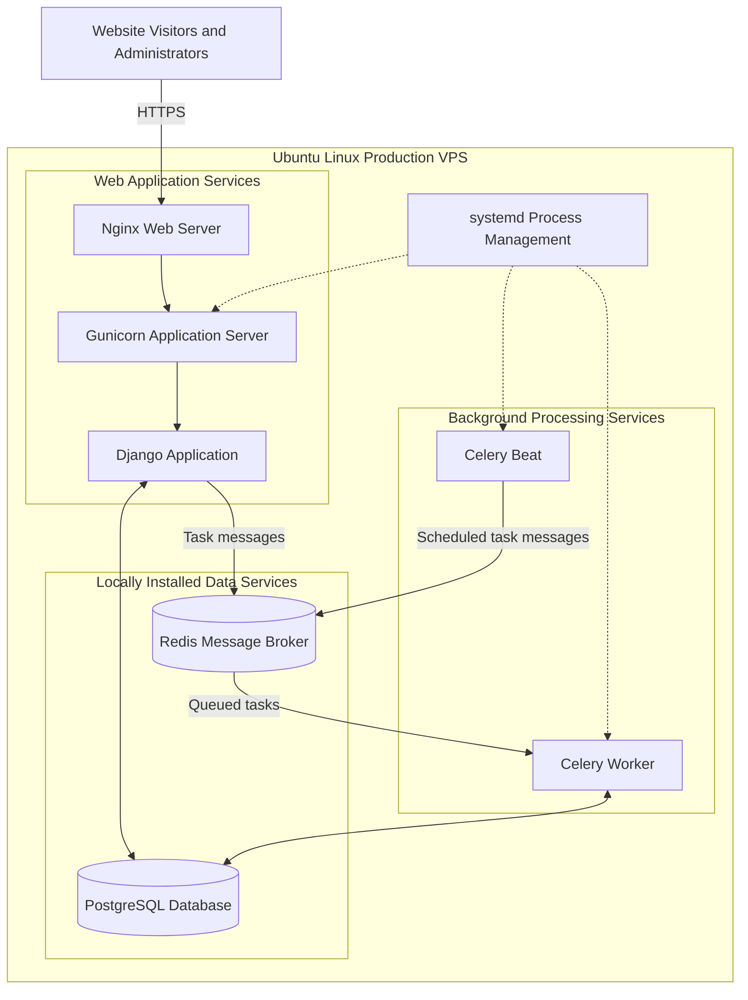
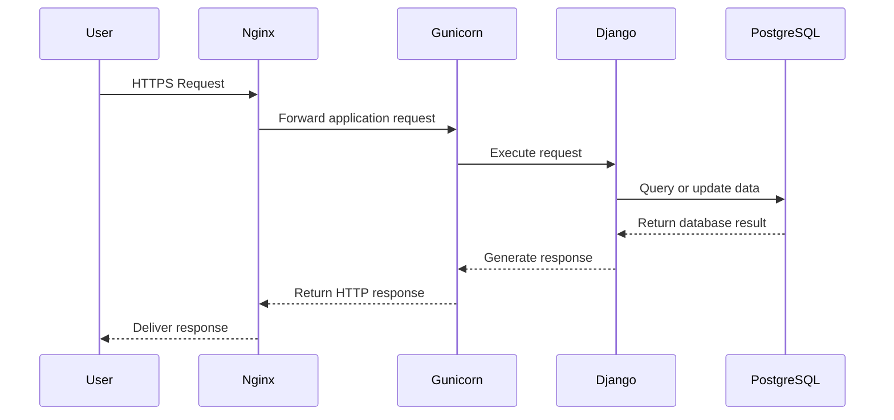
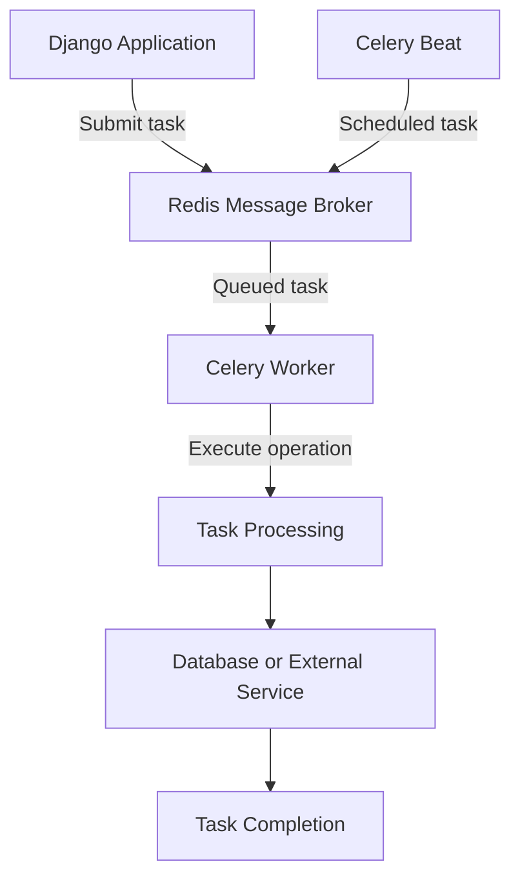

# System Architecture

## 1. Introduction

The Area47 SDA Website is built using a layered web application architecture centred around Django. The system combines a Python-based application backend, relational database, frontend asset pipeline, background task processing and Linux server infrastructure.

The architecture supports public-facing website functionality, authenticated administrative operations, content management, scheduled tasks and notification delivery.

The production application runs on a self-managed Ubuntu VPS. Nginx handles incoming web traffic, while Gunicorn serves the Django application. PostgreSQL provides persistent data storage, and Redis with Celery provides background task processing capabilities.

The architecture has evolved from a conventional Django website into a broader application and infrastructure environment incorporating email services, Progressive Web Application functionality, push notifications and containerisation initiatives.

---

## 2. High-Level System Architecture

The system is organised into several interconnected layers:

| Layer | Main Components | Responsibility |
|---|---|---|
| Presentation | Web browsers, installed PWA, Django templates | User interface and interaction |
| Frontend | Vite, Tailwind CSS, Alpine.js | Frontend development and asset management |
| Application | Django, Python | Business logic, authentication and application functionality |
| Data | PostgreSQL | Persistent application data |
| Background processing | Celery, Redis, Celery Beat | Asynchronous and scheduled task execution |
| Web serving | Nginx, Gunicorn | HTTP handling and application serving |
| Infrastructure | Ubuntu Linux, systemd | Hosting and process management |
| Communication | Web Push, Postfix, Dovecot | Push notifications and email services |

### 2.1 Production Architecture Diagram

The following diagram illustrates the production deployment topology.

**Production architecture notes:**

- All the illustrated application and supporting services run on the same Ubuntu VPS.
- Nginx handles incoming web requests and forwards application requests to Gunicorn.
- Gunicorn executes the Django application.
- PostgreSQL is installed directly on the server.
- Redis is installed directly on the server and acts as the Celery message broker.
- Celery Worker and Celery Beat operate as independently managed services.
- systemd manages the relevant application and background-processing processes.

The diagram represents the logical service relationships. Exact ports, sockets, service names and network bindings are implementation details to be documented separately.

---

## 3. Request and Response Architecture

The application follows a conventional web request-response architecture.

The production request flow is as follows:

1. A visitor or authenticated administrator accesses the website through a browser or installed Progressive Web Application.
2. The request reaches the Nginx web server.
3. Nginx handles the incoming connection and forwards application requests to Gunicorn.
4. Gunicorn executes the Django application.
5. Django processes the request using its URL configuration, views, models, middleware and business logic.
6. Where necessary, Django retrieves or modifies application data in PostgreSQL.
7. Django generates the appropriate response.
8. The response is returned through Gunicorn and Nginx to the client.

Static assets and media files are handled through the configured static and media serving mechanisms.

### 3.1 Request Flow Diagram

---

## 4. Application Architecture

Django provides the core application framework and manages the server-side functionality.

The application is organised into separate modules responsible for different areas of functionality.

These include:

- User accounts and authentication.
- Public website content.
- Blog and announcements.
- Bulletin and programme management.
- Music ministry management.
- Administrative dashboard.
- Notifications and background tasks.

This modular approach separates application responsibilities and makes the system easier to maintain and extend.

The custom administrative dashboard provides authorised staff with an interface for managing website content and operational information.

Detailed application modules and their responsibilities will be documented in the Application Features section.

---

## 5. Database Architecture

PostgreSQL is used as the primary relational database.

Django's Object-Relational Mapper (ORM) provides the interface between application models and database records.

The database stores application information such as:

- User accounts and authentication-related records.
- Website content and announcements.
- Bulletin programmes and duties.
- Music ministry information.
- Notification subscriptions and delivery logs.
- Other application-specific records.

Database schema changes are managed through Django migrations.

PostgreSQL is installed directly on the production Ubuntu VPS rather than being deployed as a Docker container or external database service.

---

## 6. Background Processing Architecture

The system uses Celery and Redis to support background task processing.

Celery workers execute tasks outside the normal HTTP request-response cycle. Redis acts as the message broker through which task messages are passed to workers.

Celery Beat provides scheduling functionality for tasks that need to execute periodically or at defined times.

This architecture allows suitable operations to run asynchronously instead of making users wait for longer-running processes to complete during a web request.

The background-processing infrastructure is particularly relevant to notification delivery and other automated operations.

### 6.1 Background Processing Flow

### 6.2 Production Deployment

In production:

- Redis is installed directly on the Ubuntu VPS.
- Celery Worker is managed through systemd.
- Celery Beat is managed through systemd.
- Background processing operates independently of the Gunicorn application processes.

In the development environment, Redis has also been introduced as a Docker service using the Redis 7 Alpine image as part of the ongoing containerisation work.

Further implementation details are documented in the Background Processing section.

---

## 7. Frontend Architecture

The frontend combines Django's server-side rendering capabilities with modern frontend tooling.

The primary technologies include:

| Technology | Responsibility |
|---|---|
| Django Templates | Server-rendered pages |
| Tailwind CSS | Styling and responsive layouts |
| Alpine.js | Lightweight client-side interactions |
| Vite | Frontend asset development and production builds |
| FullCalendar | Calendar interfaces |
| TinyMCE | Rich-text editing |

Vite manages frontend assets and generates production build files that are integrated into Django through the frontend asset integration.

This approach allows the project to maintain a Django-centred application architecture while benefiting from a modern frontend development workflow.

---

## 8. Progressive Web Application Architecture

The website includes Progressive Web Application functionality.

The PWA implementation provides an installable application experience on supported devices and uses a web app manifest and service worker.

The service worker supports caching and offline-related functionality, while the Web Push API provides a mechanism for delivering notifications to subscribed devices.

The Django backend stores push subscription information and coordinates notification operations through background processing.

The PWA extends the website experience beyond conventional browser access, particularly for users accessing the platform through installed mobile applications.

---

## 9. Production Infrastructure Architecture

The production application is hosted on a self-managed Ubuntu Linux VPS using a traditional service-based deployment architecture.

The infrastructure components include:

| Component | Responsibility |
|---|---|
| Ubuntu Server | Operating system and hosting environment |
| Nginx | Web server and reverse proxy |
| Gunicorn | Django application server |
| systemd | Process and service management |
| PostgreSQL | Relational database |
| Redis | Background task message broker |
| Celery | Background task execution |
| Celery Beat | Scheduled task management |
| Let's Encrypt | TLS certificate management |
| UFW | Firewall management |
| Fail2ban | Protection against repeated unauthorised access attempts |

### 9.1 Process Management with systemd

Systemd is used to manage the production Django application server and background-processing services.

The following services are independently managed:

- Gunicorn: serves the Django application.
- Celery Worker: executes asynchronous background tasks.
- Celery Beat: schedules periodic background tasks.

This arrangement allows services to be started, stopped, restarted and monitored independently.

It also provides process supervision and configurable startup behaviour.

### 9.2 Local Supporting Services

PostgreSQL and Redis are installed directly on the same production VPS.

This means that the production application, database and background-processing infrastructure currently operate within a single-server deployment environment.

Redis provides the message-broker functionality required by Celery, while PostgreSQL handles persistent application data.

### 9.3 Mail Infrastructure

The wider infrastructure also includes a separately configured mail-server stack.

The mail infrastructure uses Postfix and Dovecot, with PostgreSQL-backed virtual mail account management and OpenDKIM for email signing.

SPF, DKIM and DMARC are configured to support email authentication.

The mail-server architecture will be documented separately under Server Infrastructure.

---

## 10. Environment Architecture

The project maintains separate development, staging and production environments.

The environments use separate configuration settings and environment-specific values.

The staging environment provides a testing and validation stage before changes are deployed to production.

The deployment workflow includes:

1. Pulling the relevant Git branch.
2. Applying database migrations.
3. Building frontend assets.
4. Collecting static files.
5. Restarting or reloading the relevant application services when required.

The project uses a staging-first development approach to reduce the risk of introducing untested changes into production.

---

## 11. Containerisation and Infrastructure Evolution

The current production environment uses directly installed Linux services rather than Docker containers.

Containerisation is being introduced as part of the project's infrastructure improvement work.

The development Docker environment includes application and supporting service containers for the web application, Celery Worker, Celery Beat and Redis.

Redis has been containerised in development using the Redis 7 Alpine image.

The objective is to improve environment consistency and make the application infrastructure more reproducible.

Docker-based production deployment and further infrastructure automation remain ongoing development objectives.

---

## 12. Architectural and Design Considerations

The architecture reflects several important design considerations:

- Separation of application responsibilities through Django modules.
- Separation of persistent data storage from background task processing.
- Use of asynchronous processing for suitable long-running operations.
- Reverse proxy architecture for handling incoming web traffic.
- Independent management of application and background-processing services.
- Environment separation to support safer development and deployment.
- Progressive enhancement through PWA capabilities.
- Gradual adoption of containerisation and infrastructure automation.

---

## 13. Current Development Status

The system is operational with its core web application and supporting production infrastructure.

Ongoing work includes:

- Improving Docker-based environment consistency.
- Expanding deployment automation.
- Improving infrastructure reproducibility.
- Strengthening operational monitoring and documentation.
- Further refining application architecture.

The architecture will continue to evolve as these improvements are implemented.

---

## 14. Related Documentation

- [Project Overview](01-project-overview.md)
- [Application Features](03-application-features.md)
- [Background Processing](04-background-processing.md)
- [Server Infrastructure](05-server-infrastructure.md)
- [Deployment and DevOps](06-deployment-and-devops.md)
- [Security and Maintenance](07-security-and-maintenance.md)
- [Challenges and Lessons](08-challenges-and-lessons.md)
