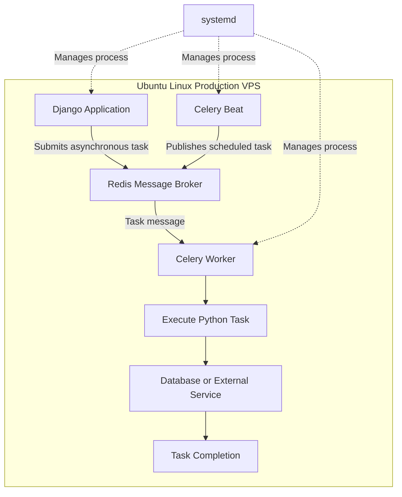
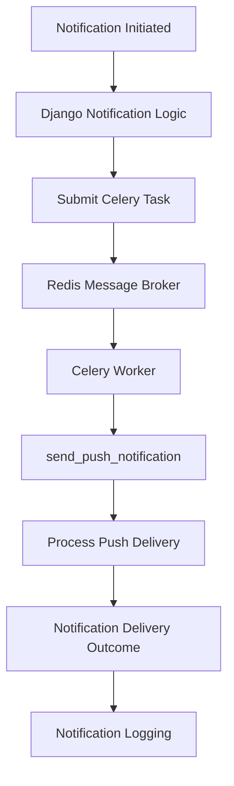
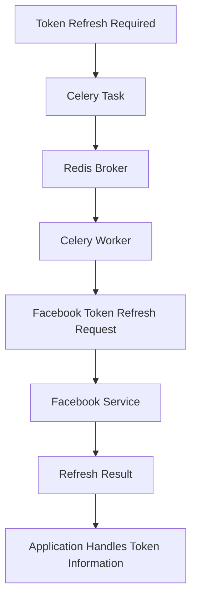
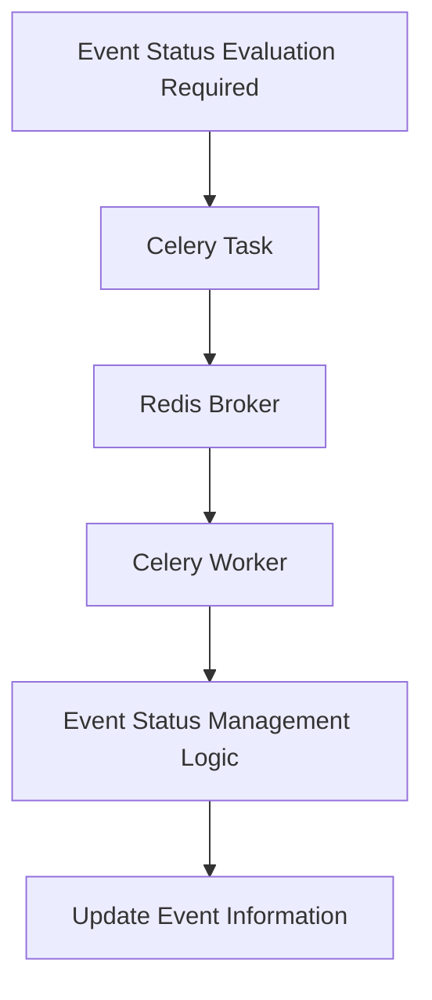
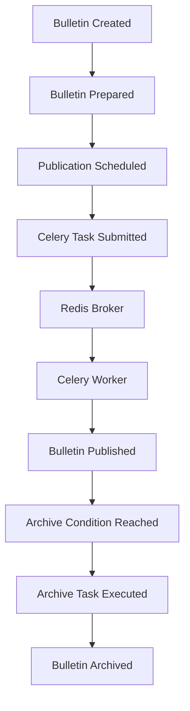
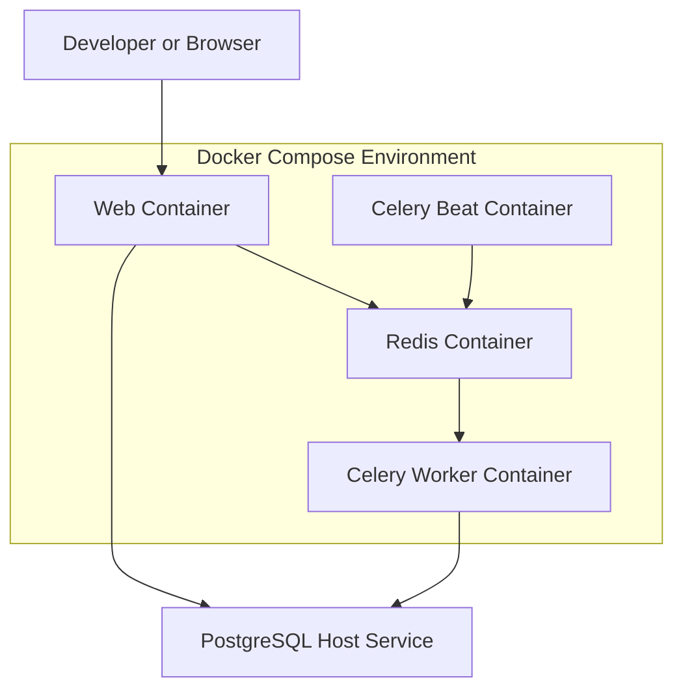

# Background Processing and Task Management

## 1. Introduction

The Area47 SDA Church website uses asynchronous background processing to automate selected application operations and execute tasks independently of the normal Django request-response cycle. As the application evolved, background processing became an important part of its functionality, supporting not only notification delivery but also social media integration, event management and automated content scheduling.

The background processing architecture is built around three main technologies:

- **Celery:** Executes asynchronous background tasks.
- **Redis:** Acts as the message broker through which tasks are communicated to workers.
- **Celery Beat:** Provides periodic task scheduling.

The project uses Celery 5.4 and integrates `django-celery-beat` for database-backed scheduling capabilities.

Background processing is used in several areas of the application, including:

- Push notification delivery.
- Facebook access-token refresh for video and live content functionality.
- Event status management.
- Scheduled bulletin publishing.
- Bulletin archiving.

This document explains the architecture, task execution workflow, application integrations and production service management.

## 2. Background Processing Architecture

### 2.1 Overview

Django handles normal web requests and application logic. When an operation needs to be processed asynchronously or at a scheduled time, it can be delegated to Celery. Instead of requiring the web request to wait for an operation to finish, the application can submit a task to the message broker.

Redis receives the task message and makes it available to a Celery worker. The worker retrieves the task and executes the associated Python function. Celery Beat provides a separate mechanism for determining when periodic tasks should be submitted for execution.

This architecture allows different application operations to run independently of the main web application process.

### 2.2 Architecture Diagram

The following diagram illustrates the relationship between the main background processing components.

*Note: This is a logical representation of the production architecture. It does not specify exact network bindings or service unit configurations.*

## 3. Celery

### 3.1 Overview

Celery is the background task processing system used by the application. It allows selected application operations to execute independently of the web request that initiated them. This is particularly useful for operations involving external services, scheduled content management, notification delivery and automated application maintenance.
The project uses Celery version 5.4.

### 3.2 Task Execution

A Celery task is a Python function registered with the Celery application. When the application submits a task for asynchronous execution, Celery creates a message containing the information required to identify and execute that task. The message is passed through the configured broker and retrieved by an available worker. The worker executes the corresponding task function. This separation allows the Django application and background workers to perform their responsibilities independently.

### 3.3 Application Integration

Celery is integrated into the Django project so that different application modules can define and submit background tasks.

The application uses background processing for several operational requirements:

| Application area | Background processing responsibility |
|---|---|
| Notifications | Push notification delivery |
| Facebook integration | Access-token refresh for video and live content functionality |
| Events | Event status management |
| Bulletin | Scheduled publishing |
| Bulletin | Automated archiving |

These integrations demonstrate how background processing supports both communication features and routine application operations.

## 4. Redis Message Broker

### 4.1 Overview

Redis is used as the message broker for Celery. Its responsibility is to facilitate communication between task producers and task consumers.

In this architecture:

- Django can publish task messages.
- Celery Beat can publish scheduled task messages.
- Celery workers consume available task messages.

Redis therefore acts as the communication layer connecting the application to the background processing system.

### 4.2 Production Deployment
In the production environment, Redis is installed directly on the Ubuntu VPS. It operates alongside the Django application, PostgreSQL, Gunicorn and Celery services.

### 4.3 Development Containerisation
In the development containerisation setup, Redis is provided through a Docker container using:

`redis:7-alpine` This allows the development environment to run its own Redis service independently of the host installation.

### 4.4 Role in the Architecture
Redis helps separate task submission from task execution. The Django application does not need to execute every background operation itself. Instead, it submits work to the broker, allowing workers to process tasks independently.

## 5. Celery Workers

### 5.1 Overview

Celery workers are responsible for executing background tasks. A worker listens for task messages from the configured broker and processes tasks using the Python functions registered with the Celery application.

### 5.2 Worker Responsibilities

The worker is responsible for:

- Receiving available task messages.
- Identifying the task to execute.
- Executing the associated Python function.
- Interacting with application resources when required.
- Communicating with external services when required.
- Reporting task execution outcomes to Celery.

### 5.3 Production Management

In production, the Celery worker runs as a Linux service managed by systemd. This provides process management independently of the Django web application. It also allows the worker to be started, stopped, restarted and inspected through the Linux service management system.

The production deployment separates the responsibilities of:

- Gunicorn: serving Django web requests.
- Celery worker: executing background tasks.
- Celery Beat: scheduling periodic tasks.

## 6. Celery Beat and Scheduled Tasks

### 6.1 Overview

Celery Beat is the task scheduler component of the background processing architecture. While Celery workers execute tasks, Beat determines when periodic tasks should be submitted for execution. This makes it possible to automate operations that need to run at defined intervals or scheduled times.

### 6.2 Database-Backed Scheduling

The project includes `django-celery-beat`, which provides database-backed scheduling functionality. This integration allows periodic task schedules to be managed through Django's database-backed scheduling mechanisms. It provides a foundation for managing scheduled operations without relying exclusively on static scheduling definitions in application code.

### 6.3 Scheduling Workflow

The general scheduling workflow is:

1. A periodic task schedule is configured.
2. Celery Beat evaluates the schedule.
3. When a task becomes due, Beat publishes the task message to Redis.
4. A Celery worker retrieves the task.
5. The worker executes the task.

### 6.4 Application Scheduling Use Cases

The application uses Celery-based processing for scheduled operations in different modules.

These include:

- Managing event statuses.
- Publishing bulletins at their scheduled publication times.
- Archiving bulletins when they reach their configured archive point.
- Refreshing Facebook access tokens for video and live content functionality.

The exact scheduling mechanism can differ between operations. Tasks may be submitted through periodic schedules or scheduled execution mechanisms implemented within the application.

### 6.5 Production Management

Celery Beat runs as a separate Linux service managed by systemd. Keeping Beat separate from the worker makes their responsibilities easier to manage and troubleshoot.

## 7. Push Notification Delivery

### 7.1 Overview

Push notification delivery is one example of asynchronous processing within the Area47 SDA application. The notification system allows the application to manage push subscriptions and deliver notifications to supported devices. The delivery operation is integrated with Celery so that notification processing can happen independently of the main web request.

### 7.2 Notification Models

The notification module includes the following models:

- `PushSubscription`
- `AdminNotification`
- `NotificationLog`

Their responsibilities include managing push subscription information, administrative notifications and notification delivery records.

### 7.3 Notification Task

The push notification task is implemented in:

`notifications.tasks.send_push_notification` This task provides the background processing entry point for notification delivery. Rather than requiring the web application to perform the entire notification delivery process during a normal request, the operation can be delegated to Celery.

### 7.4 Notification Processing Flow

*Note: This diagram represents the overall processing concept. The exact order of database updates, delivery attempts and logging should be verified against the task implementation.*

### 7.5 Delivery Monitoring

The notification system includes a `NotificationLog` model for recording notification activity. This provides a foundation for reviewing delivery attempts and investigating failures. The subscription model also supports maintaining information about registered devices and their notification subscriptions. These records are useful when diagnosing delivery problems and monitoring the notification system.

## 8. Facebook Integration and Access-Token Management

### 8.1 Overview

The application integrates with Facebook for video and live content functionality. This integration requires the application to manage Facebook access tokens used when communicating with Facebook services. Celery is used to handle access-token refresh operations in the background.

### 8.2 Token Refresh Automation

Access tokens have validity periods and may need to be refreshed to maintain the application's ability to communicate with the relevant Facebook services. The application uses background processing to automate token refresh operations. This reduces the need for manual intervention whenever a token needs to be renewed.

### 8.3 Integration with Video and Live Content

The Facebook integration supports functionality associated with video and live content. Maintaining valid access credentials is important for keeping the integration operational. By delegating token refresh operations to Celery, the application can perform this maintenance independently of normal user interactions.

### 8.4 Processing Workflow

The general workflow is:

1. The configured token refresh operation becomes due or is initiated.
2. The application submits the refresh task for background processing.
3. Redis receives the task message.
4. A Celery worker executes the refresh operation.
5. The application communicates with the relevant Facebook service.
6. The refreshed token information is handled by the application.

*Note: This diagram describes the logical integration. Token storage, expiry validation, error handling and exact refresh implementation should be documented from the source code.*

### 8.5 Operational Importance

Automating token refresh is important because external service integrations depend on valid authentication credentials. Background processing provides a way to maintain these credentials without making token maintenance a manual part of normal application operation.

## 9. Event Status Management

### 9.1 Overview

The application also uses Celery for event status management. Event-related information may have a lifecycle in which its status changes as time passes or as defined application conditions are met. Background processing allows the application to manage these status changes without depending entirely on a user opening the relevant page.

### 9.2 Automated Status Management

Celery tasks support the execution of event status management operations. This allows event-related application logic to run independently of normal web requests.

### 9.3 Processing Workflow

The general workflow is:

1. An event reaches a point where its status needs to be evaluated.
2. The relevant Celery task is submitted.
3. Redis passes the task message to a worker.
4. The worker executes the event status management logic.
5. The application updates the relevant event information when required.

### 9.4 Purpose

Automating event status management helps keep event information aligned with its lifecycle and reduces dependence on manual administrative updates.

## 10. Bulletin Scheduling and Archiving

### 10.1 Overview

The bulletin module uses Celery to automate parts of the bulletin lifecycle. Church bulletins contain programme information and other details intended for publication at specific times. The application uses background processing to support scheduled publication and archiving.

### 10.2 Scheduled Bulletin Publishing

The application supports scheduling when a bulletin should be published. Instead of requiring an administrator to manually publish every bulletin at the exact publication time, the application can use background processing to execute the publishing operation.
The scheduled operation is handled through the Celery task processing architecture.

### 10.3 Bulletin Archiving

The application also uses Celery for bulletin archiving. Archiving supports the management of older bulletin records and their transition out of the active publication workflow.
This helps keep current bulletin information separate from historical content.

### 10.4 Bulletin Lifecycle

The general bulletin lifecycle can be represented as follows:

*Note: This diagram illustrates the intended lifecycle. Actual model statuses, scheduling mechanisms and archive conditions should be verified against the implementation.*

### 10.5 Administrative Benefits

Automated bulletin scheduling and archiving provide several benefits:

- Reduces repetitive manual administrative work.
- Supports publication at predefined times.
- Helps maintain an organised bulletin lifecycle.
- Separates active bulletins from archived information.
- Allows publication and archiving operations to run independently of user requests.

## 11. Production Service Management

### 11.1 Overview

The production background processing environment runs directly on the Ubuntu Linux VPS. Celery components are managed as Linux services through systemd.
This provides a consistent approach to managing long-running application processes.

### 11.2 Service Responsibilities

The production environment separates application responsibilities into distinct processes.

| Component | Responsibility |
|---|---|
| Gunicorn | Runs the Django application and serves web requests |
| Celery Worker | Executes asynchronous background tasks |
| Celery Beat | Publishes scheduled tasks |
| Redis | Provides the Celery message broker |
| PostgreSQL | Stores application data |

### 11.3 systemd Integration

systemd is used to manage the Gunicorn, Celery worker and Celery Beat processes. This allows the services to be controlled independently.

Typical administrative operations include:

- Checking service status.
- Starting and stopping services.
- Restarting services after configuration or code changes.
- Inspecting service logs.
- Investigating process failures.

The actual service unit names and configurations should be referenced in the server infrastructure documentation rather than assumed here.

### 11.4 Operational Considerations

Background processing services require ongoing attention.

Important operational considerations include:

- Ensuring Redis is available to the application and workers.
- Confirming that workers are running.
- Ensuring Celery Beat is running when scheduled processing is required.
- Reviewing logs when tasks fail.
- Monitoring task execution and notification delivery.
- Monitoring Facebook token refresh operations.
- Ensuring scheduled publishing and archiving operations execute as expected.
- Ensuring service processes recover appropriately after failures.

## 12. Development Containerisation

### 12.1 Overview

The project also has an ongoing Docker containerisation setup for development and staging workflows. This provides a more reproducible environment for running the application and its supporting background processing services.

### 12.2 Container Services

The current Docker Compose setup includes separate services for:

- Web application.
- Celery worker.
- Celery Beat.
- Redis.

Redis is provided using the `redis:7-alpine` image. The web application and background processing components run as separate containers while sharing the configured application environment and supporting services.

### 12.3 Container Architecture

*Note: This diagram represents the development containerisation arrangement. PostgreSQL is accessed through the host environment in the current setup, rather than being represented as a PostgreSQL Compose container.*

### 12.4 Development and Production Differences

The production environment currently uses services installed directly on the VPS. The development containerisation setup separates the web application, worker, Beat and Redis into containers. This distinction is important because the project is not yet fully containerised in production.

## 13. Background Processing Design Considerations

### 13.1 Separation of Responsibilities

The use of separate components allows the system to divide responsibilities between request handling, task scheduling, message brokering and task execution. This makes the architecture easier to understand and manage.

### 13.2 Responsiveness

Delegating selected operations to background workers helps prevent longer-running tasks from unnecessarily extending the time required to complete a web request.

### 13.3 Automation

Background processing supports automation across different application areas. This includes communication, external service integration, event lifecycle management and bulletin publication.

### 13.4 Maintainability

Keeping task definitions within the relevant Django application modules helps maintain a logical relationship between application functionality and its background processing requirements.

### 13.5 Operational Reliability

The use of systemd provides process management for long-running services. Redis, Celery workers and Celery Beat must remain appropriately configured and available for asynchronous and scheduled processing to work correctly.

### 13.6 Future Improvements

Potential areas for further improvement include:

- More detailed task monitoring.
- Structured task failure reporting.
- Documented retry policies where appropriate.
- Monitoring worker availability and task queues.
- Improved operational alerting.
- Monitoring external API availability.
- Monitoring scheduled task execution.
- Containerised deployment of the complete application stack.

These are improvement opportunities and should not be interpreted as features already implemented.

## 14. Summary

The Area47 SDA application uses Celery, Redis and Celery Beat to support asynchronous and scheduled background processing. Celery workers execute background tasks, Redis provides the message broker, and Celery Beat provides periodic scheduling capabilities.

Background processing is integrated into several important application workflows:

- Push notification delivery.
- Facebook access-token refresh for video and live content functionality.
- Event status management.
- Scheduled bulletin publishing.
- Bulletin archiving.

In production, the background processing components run as Linux services managed by systemd on the Ubuntu VPS. The project also has an ongoing Docker-based development and staging setup, providing a foundation for more reproducible application environments. Together, these technologies demonstrate the integration of backend application development, external service integration, workflow automation and Linux server administration.

## 15. Related Documentation

- [Project Overview](01-project-overview.md)
- [System Architecture](02-system-architecture.md)
- [Application Features](03-application-features.md)
- [Server Infrastructure](05-server-infrastructure.md)
- [Deployment and DevOps](06-deployment-and-devops.md)
- [Security and Maintenance](07-security-and-maintenance.md)
- [Challenges and Lessons Learned](08-challenges-and-lessons.md)
