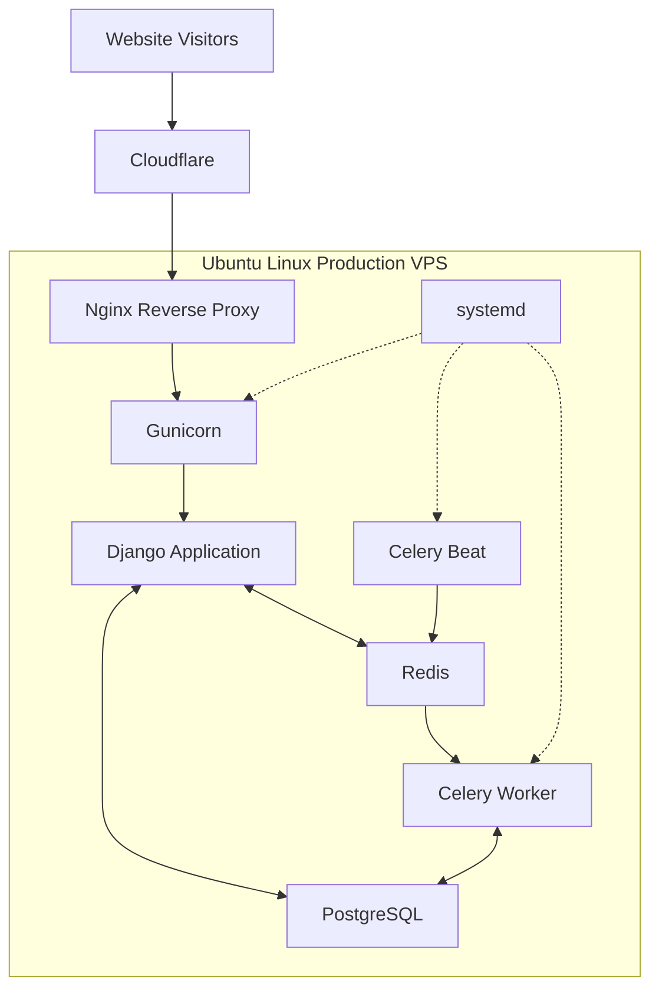
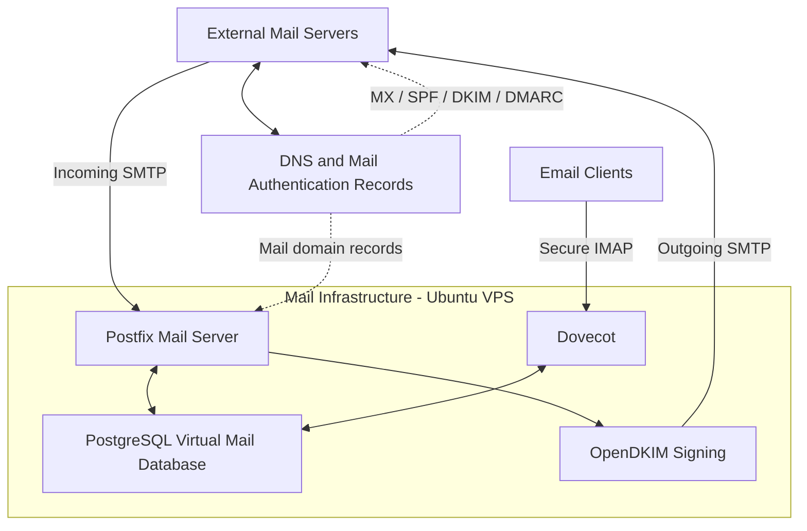

# Server Infrastructure and System Administration

## 1. Introduction

The Area47 SDA Church website is hosted on a self-managed Ubuntu Linux VPS. The infrastructure supports the Django application, database services, background processing, website delivery, email services and security controls.

The production environment combines several Linux services and open-source technologies to provide a complete hosting environment.

The main infrastructure components include:

- Ubuntu Linux Server
- Nginx
- Gunicorn
- Django
- PostgreSQL
- Redis
- Celery
- systemd
- Postfix
- Dovecot
- OpenDKIM
- Cloudflare
- Let's Encrypt
- UFW
- Fail2ban

This document describes the production infrastructure, service responsibilities, mail server architecture, network security and operational management.

## 2. Production Server Environment

### 2.1 Operating System

The production environment runs on Ubuntu Server 24.04 LTS. Ubuntu provides the Linux operating system on which the application's services and supporting infrastructure are installed.

It is responsible for:

- Running the application services.
- Managing system processes.
- Providing network and storage resources.
- Managing installed software packages.
- Supporting firewall and security configurations.
- Providing the environment for database and mail services.

### 2.2 Hosting Architecture

The production environment uses a traditional Linux server deployment model. The main application services are installed and managed directly on the VPS rather than running entirely inside Docker containers. This provides direct experience with Linux service configuration, process management, networking, deployment and server maintenance. Eventually the production environment will also be containerised.

### 2.3 Production Directory Structure

The production application is deployed under:

`/var/www/Area47Website`

The staging application is maintained separately under:

`/var/www/Area47Website_staging`

Keeping production and staging deployments in separate directories helps isolate application environments and their respective configurations.

## 3. Production Architecture

### 3.1 Overview

The production environment consists of several interconnected services.

`Nginx` handles incoming web traffic and acts as the reverse proxy for the Django application.

`Gunicorn` runs the Django application and serves requests forwarded by Nginx.

`PostgreSQL` provides persistent application data storage, while Redis supports Celery background processing.

`Celery workers and Celery Beat` run as separate services managed by systemd.

The mail server operates alongside the web application and provides email-related services.

### 3.2 Production Infrastructure Diagram

*Note: This is a logical architecture diagram. It illustrates the main production services and their responsibilities rather than exact network bindings, ports or process configurations.*

## 4. Web Server and Application Hosting

### 4.1 Nginx

Nginx is used as the web server and reverse proxy in the production environment. It receives incoming HTTP and HTTPS requests and forwards application requests to Gunicorn.

Its responsibilities include:

- Handling incoming web traffic.
- Acting as a reverse proxy.
- Serving applicable static resources.
- Supporting HTTPS configuration.
- Forwarding application requests to Gunicorn.

Nginx provides the public-facing entry point for the hosted Django application.

### 4.2 Gunicorn

Gunicorn is the WSGI application server used to run Django in production. It provides the process environment through which the Django application handles incoming requests.

Nginx forwards application requests to Gunicorn, which passes them to Django for processing.

Gunicorn is managed as a Linux service using systemd.

### 4.3 Django Application

Django contains the business logic and application functionality. It communicates with supporting services such as PostgreSQL and Redis and provides the application functionality accessed through the web interface. The application is deployed in separate production and staging environments.

## 5. Database Infrastructure

### 5.1 PostgreSQL

PostgreSQL is used as the primary relational database management system. It stores the application's persistent data, including information required by the different Django modules. The database runs directly on the production Ubuntu VPS.

### 5.2 Application Integration

Django communicates with PostgreSQL through its configured database connection. The database supports the application's different functional areas, including:

- User accounts.
- Website content.
- Bulletin information.
- Music ministry information.
- Notifications and push subscriptions.
- Offering plan functionality.
- Event and other application records.

### 5.3 Database Administration

Operating PostgreSQL as part of a self-managed VPS environment requires attention to:

- Database availability.
- User and permission management.
- Connection configuration.
- Database backups.
- Database maintenance.
- Monitoring storage utilisation.
- Recovery planning.

The database is an important component of the production infrastructure because application functionality depends on the availability and integrity of its stored information.

## 6. Background Processing Infrastructure

### 6.1 Redis

Redis is installed directly on the production VPS. It acts as the message broker for the Celery background processing system. Redis facilitates communication between the Django application, Celery Beat and Celery workers.

### 6.2 Celery Worker

The Celery worker runs as a separate Linux service. It executes background tasks submitted through the configured Redis broker.

### 6.3 Celery Beat

Celery Beat is responsible for publishing scheduled tasks. It operates separately from the worker and submits scheduled work through Redis for execution.

### 6.4 systemd Management

The production environment uses systemd to manage:

- Gunicorn.
- Celery worker.
- Celery Beat.

This provides independent process management for the web application and background processing components. Detailed background processing workflows are documented in:
[Background Processing](04-background-processing.md)

## 7. Mail Server Infrastructure

### 7.1 Overview

The infrastructure includes a self-managed email server built using open-source Linux mail technologies. The mail server operates alongside the website infrastructure and provides email services for the configured domain.

The main components include:

- Postfix
- Dovecot
- PostgreSQL
- OpenDKIM
- SPF
- DKIM
- DMARC

The mail server uses: `mail.area47sda.com`

### 7.2 Postfix

Postfix is used as the Mail Transfer Agent (MTA). Its responsibilities include handling mail transfer and delivery between the configured mail environment and external mail servers. It forms the foundation of the mail server's SMTP functionality.

### 7.3 Dovecot

Dovecot provides mailbox access services. It allows supported email clients to access mailboxes using IMAP over an encrypted connection. The server provides IMAP access through port 993.

### 7.4 Virtual Mailbox Management

The mail server uses PostgreSQL for virtual mail domain and mailbox information. Mail users are managed separately from the Django authentication user accounts.

The virtual mail infrastructure uses a database table named: `website_mailuser`

This allows email accounts to be managed through a dedicated mail-user data structure rather than requiring every mailbox to correspond to a Django application login account.

### 7.5 OpenDKIM

OpenDKIM is integrated into the mail infrastructure to provide DKIM signing. DKIM adds a cryptographic signature to outgoing email messages, allowing receiving mail systems to verify that the message was signed by an authorised sending domain.

### 7.6 SPF

Sender Policy Framework (SPF) is configured through DNS records. SPF identifies the mail servers authorised to send email on behalf of the domain. It helps receiving mail systems evaluate whether a message originates from an authorised sending server.

### 7.7 DMARC

Domain-based Message Authentication, Reporting and Conformance (DMARC) provides an additional email authentication and policy layer. It allows domain owners to specify how receiving systems should handle messages that fail the configured authentication checks. The domain's DMARC policy is configured for quarantine.

### 7.8 Mail Server Architecture Diagram

The following diagram illustrates the main mail server components and their relationships.

*Note: This is a conceptual mail architecture diagram. Exact Postfix-to-Dovecot integration, delivery paths, authentication lookups and SMTP ports should be verified against the actual mail configuration.*

### 7.9 Mail Server Responsibilities

The mail infrastructure provides several important capabilities:

- Receiving incoming email.
- Sending outgoing email.
- Managing virtual mailboxes.
- Providing secure mailbox access.
- Authenticating mail users.
- Signing outgoing messages using DKIM.
- Supporting SPF and DMARC authentication policies.

### 7.10 Mail and Application Separation

The mail server and Django authentication system serve different purposes. The Django application uses its custom user model for website authentication. The mail server maintains its own virtual mailbox information. This separation allows website accounts and email accounts to be managed independently.

## 8. Domain and DNS Infrastructure

### 8.1 Domain Configuration

The infrastructure uses the following domain structure:

| Domain | Purpose |
|---|---|
| `area47sda.com` | Main website |
| `staging.area47sda.com` | Staging website |
| `mail.area47sda.com` | Mail server hostname |

### 8.2 Cloudflare

Cloudflare is used for domain DNS management and website-related infrastructure support. It provides a central location for managing DNS records and related domain configuration. DNS configuration is important for ensuring that web and mail services resolve to their intended destinations.

### 8.3 Mail DNS Configuration

The mail infrastructure relies on correctly configured DNS records.

Important record types include:

- MX records for mail routing.
- A records for hostname resolution.
- SPF TXT records for sender authorisation.
- DKIM TXT records for public key verification.
- DMARC TXT records for email authentication policy.

Mail-related hostnames must be configured appropriately for email services. In particular, mail DNS records must use suitable DNS-only resolution rather than relying on ordinary web traffic proxying.

## 9. SSL/TLS and HTTPS

### 9.1 Overview

The infrastructure uses Let's Encrypt certificates to support encrypted connections. TLS is important for protecting communication between users, clients and hosted services.

### 9.2 Website HTTPS

The website is configured to support HTTPS through the Nginx web server. This allows visitors to communicate with the hosted application over an encrypted connection.

### 9.3 Mail TLS

The mail infrastructure also uses TLS certificates for secure mail services.

The configured mail hostname is: `mail.area47sda.com`

The certificate configuration should be maintained to ensure that the mail services present valid certificates for their respective hostnames.

## 10. Server Security and Access Management

### 10.1 SSH Access

SSH provides remote administrative access to the Ubuntu VPS.

The server uses a non-default SSH port: `21034`

Changing the default SSH port helps reduce exposure to automated scanning targeting the conventional SSH port, although it is not a replacement for proper authentication and firewall controls.

### 10.2 UFW Firewall

Uncomplicated Firewall (UFW) is used for host-level firewall management. It provides a way to control which network connections are permitted to reach the server. Firewall rules are important for limiting public access to the services that need to be externally reachable.

### 10.3 Fail2ban

Fail2ban is installed to help protect the server against repeated suspicious authentication attempts. It monitors configured logs and can apply temporary bans to addresses associated with repeated failures. This provides an additional security layer for exposed services.

### 10.4 Security Considerations

Important server security practices include:

- Restricting unnecessary network access.
- Maintaining firewall rules.
- Monitoring authentication activity.
- Applying operating system security updates.
- Protecting application environment variables.
- Securing database access.
- Maintaining valid TLS certificates.
- Reviewing service logs.
- Protecting mail authentication credentials and signing keys.

## 11. Production and Staging Environments

### 11.1 Overview

The project maintains separate production and staging environments. This separation supports testing application changes before they are introduced into the live website.

### 11.2 Environment Structure

| Environment | Domain | Application directory |
|---|---|---|
| Production | `area47sda.com` | `/var/www/Area47Website` |
| Staging | `staging.area47sda.com` | `/var/www/Area47Website_staging` |

### 11.3 Branch Strategy

The project uses separate Git branches for the two environments.

- `main` is associated with production.
- `staging` is associated with staging.

This provides a structured workflow for testing changes before production deployment.

### 11.4 Environment Configuration

Each environment uses its own environment configuration. The Django settings are separated to support development, staging and production configurations.

Sensitive configuration values are maintained outside the application source code through environment-specific environment files.

## 12. Development Containerisation

### 12.1 Overview

Although the production infrastructure currently uses directly installed Linux services, the project also has an ongoing Docker containerisation setup. The containerisation work is intended to improve development and staging environment consistency and support more reproducible deployments.

### 12.2 Docker Services

The current Docker Compose setup includes:

- Django web application.
- Celery worker.
- Celery Beat.
- Redis.

The Redis service uses: `redis:7-alpine`

### 12.3 Production and Development Differences

The current deployment approaches are different:

**Production**
- Ubuntu Linux VPS.
- Nginx and Gunicorn installed as Linux services.
- PostgreSQL installed directly on the server.
- Redis installed directly on the server.
- Celery worker and Beat managed by systemd.

**Development containerisation**
- Docker Compose.
- Separate web application container.
- Separate Celery worker container.
- Separate Celery Beat container.
- Redis container.
- PostgreSQL accessed through the configured host environment.

The project is not yet fully containerised in production.

## 13. Infrastructure Monitoring and Maintenance

### 13.1 Service Monitoring

A self-managed VPS requires regular monitoring of the services that support the application.

Important services include:

- Nginx.
- Gunicorn.
- PostgreSQL.
- Redis.
- Celery worker.
- Celery Beat.
- Postfix.
- Dovecot.

### 13.2 Log Inspection

Linux service logs provide important information for diagnosing application and infrastructure issues.

Useful operational activities include:

- Checking service status.
- Reviewing system logs.
- Inspecting application errors.
- Investigating database connection issues.
- Checking mail service logs.
- Reviewing background task failures.
- Monitoring authentication activity.

### 13.3 Maintenance Responsibilities

Regular maintenance activities include:

- Updating installed packages.
- Monitoring server storage and memory usage.
- Checking service availability.
- Maintaining database backups.
- Monitoring certificate expiry.
- Reviewing firewall configuration.
- Investigating mail delivery problems.
- Monitoring background processing services.

## 14. Infrastructure Design Considerations

### 14.1 Service Separation

The infrastructure separates the responsibilities of the web server, application server, database, background processing system and mail server. This makes it easier to identify and manage individual services.

### 14.2 Independent Process Management

Using systemd to manage application services provides a consistent approach to operating long-running processes.

### 14.3 Self-Managed Infrastructure

Operating the VPS provides practical experience in Linux administration, service configuration, networking, deployment and troubleshooting.

### 14.4 Reproducibility

The ongoing Docker containerisation work provides a foundation for improving the reproducibility of development and staging environments.

### 14.5 Future Infrastructure Improvements

Potential improvements include:

- More comprehensive infrastructure monitoring.
- Automated server provisioning.
- Infrastructure configuration management using Ansible.
- More complete Docker-based deployment.
- Improved backup automation and recovery testing.
- Centralised log management.
- More detailed mail delivery monitoring.

These are areas for future development and should not be interpreted as fully implemented capabilities.

## 15. Summary

The Area47 SDA Church website runs on a self-managed Ubuntu Linux VPS supporting web hosting, application services, database storage, background processing and email infrastructure.

The production environment combines Nginx, Gunicorn, Django, PostgreSQL, Redis, Celery and systemd to provide the application hosting platform.

The infrastructure also includes a self-managed mail server built around Postfix, Dovecot, PostgreSQL and OpenDKIM, with SPF and DMARC configured for email authentication.

Cloudflare, Let's Encrypt, UFW and Fail2ban provide additional domain, encryption and security capabilities.

Maintaining this environment involves practical Linux server administration, service management, networking, application deployment, database operations, mail server administration and infrastructure troubleshooting.

## 16. Related Documentation

- [Project Overview](01-project-overview.md)
- [System Architecture](02-system-architecture.md)
- [Application Features](03-application-features.md)
- [Background Processing](04-background-processing.md)
- [Deployment and DevOps](06-deployment-and-devops.md)
- [Security and Maintenance](07-security-and-maintenance.md)
- [Challenges and Lessons Learned](08-challenges-and-lessons.md)
