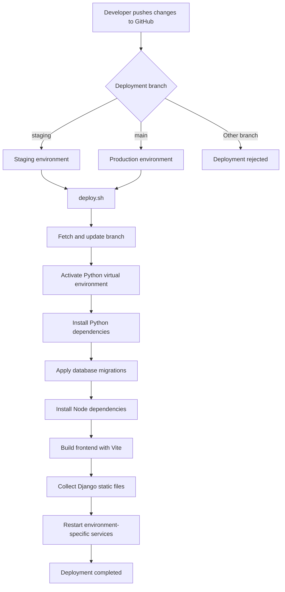
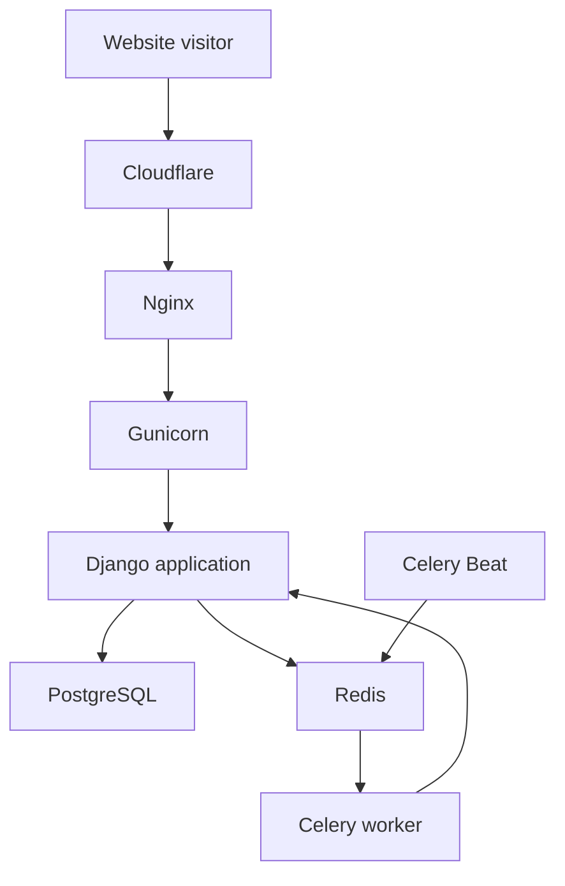
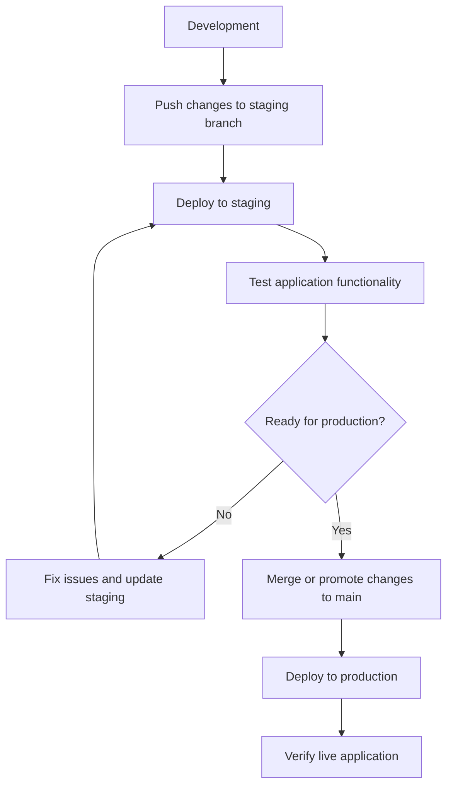

# Deployment and DevOps

## 1. Overview

The Area47 SDA Church website is deployed on an Ubuntu 24.04 VPS using a structured deployment workflow that separates staging and production environments.

The deployment process combines Git-based version control, environment-specific application directories, Python virtual environments, database migrations, frontend asset compilation, Django static file collection, and Linux system service management.

A custom Bash deployment script (`deploy.sh`) is used to automate the deployment process. It identifies the target environment based on the currently selected Git branch and executes the corresponding deployment operations.

The deployment approach prioritises:

- Separation of staging and production environments.
- Consistent application updates.
- Automated deployment operations.
- Controlled database migrations.
- Reliable frontend asset compilation.
- Restarting the appropriate application services.
- Testing changes in staging before production deployment.

## 2. Deployment Architecture

The application is maintained in a Git repository with two primary deployment branches:

| Branch | Environment | Deployment directory |
|---|---|---|
| `staging` | Staging | `/var/www/Area47Website_staging` |
| `main` | Production | `/var/www/Area47Website` |

Each environment maintains its own application directory, Python virtual environment, environment configuration, and system services. The two environments operate independently, allowing changes to be tested without directly affecting the live website.

### Deployment flow



## 3. Automated Deployment Script

A custom Bash script, `deploy.sh`, is used to manage application deployments on the VPS. Rather than maintaining separate deployment procedures for staging and production, the script uses the currently selected Git branch to determine which environment should receive the deployment.

### Environment selection

The script recognises two deployment branches:

- `staging` deploys to the staging application directory.
- `main` deploys to the production application directory.

If another branch is selected, the script rejects the deployment instead of proceeding with an unsupported environment. This provides a basic safeguard against accidentally deploying development or feature branches.

### Deployment operations

For the selected environment, the script performs the following operations:

| Stage | Operation | Purpose |
|---|---|---|
| 1 | Git update | Fetches the latest remote changes and synchronises the deployment directory with the selected branch. |
| 2 | Virtual environment | Activates the environment-specific Python virtual environment. |
| 3 | Dependency installation | Installs or updates Python dependencies from the Linux requirements file. |
| 4 | Database migrations | Applies pending Django database migrations. |
| 5 | Node dependencies | Installs frontend dependencies using npm. |
| 6 | Vite build | Removes previous Vite build artifacts and compiles the frontend assets. |
| 7 | Static file collection | Clears the previous collected static files and runs Django's `collectstatic` command. |
| 8 | Service restart | Restarts the Celery worker, Celery Beat, and Gunicorn services associated with the selected environment. |
| 9 | Nginx reload | Reloads Nginx to apply relevant configuration changes without a full service restart. |

The script uses strict Bash execution settings to help prevent deployment from continuing after command failures.

### Environment-specific service management

The deployment script also handles service restarts according to the selected environment.

| Service | Staging | Production |
|---|---|---|
| Gunicorn | `gunicorn_staging` | `gunicorn` |
| Celery worker | `celery_staging` | `celery_production` |
| Celery Beat | `celery_beat_staging` | `celery_beat_production` |
| Nginx | Reloaded | Reloaded |

This ensures that deploying to staging does not intentionally restart the production application services, and vice versa.

### Deployment execution

The deployment script is executed from the VPS using the appropriate deployment branch.

The general workflow is:

1. Update the required branch in the Git working repository.
2. Execute the deployment script.
3. The script identifies the branch and selects the corresponding environment.
4. Deployment operations are performed automatically.
5. The script reports completion or stops if a command fails.

The deployment script is maintained separately from the application's deployment documentation. Its implementation may evolve as deployment safeguards and automation are improved.

## 4. Python Environment Management

Python dependencies are managed through environment-specific virtual environments. Each application environment has its own virtual environment, preventing Python package installations in one environment from directly affecting the other.

The project uses a structured requirements directory:

```text
requirements/
├── base.txt
├── linux.txt
└── windows.txt
```

- `base.txt` contains shared application dependencies.
- `linux.txt` contains dependencies required for Linux deployments and includes the shared requirements.
- `windows.txt` supports local Windows development.

During deployment, the script activates the selected environment's virtual environment and installs dependencies from `requirements/linux.txt`. This helps keep the server environments aligned with the application's dependency definitions.

## 5. Frontend Build and Static File Management

The application uses Vite to compile frontend assets.

The frontend stack includes:

- Vite
- Tailwind CSS v4
- Alpine.js
- JavaScript modules
- Django Vite integration

Frontend dependencies are managed through npm.

During deployment, the script:

1. Installs Node dependencies.
2. Removes the previous Vite distribution directory.
3. Recreates the distribution directory.
4. Runs the production frontend build.
5. Removes previously collected Django static files.
6. Runs Django's `collectstatic` command.

The Vite build generates the frontend assets and manifest consumed by the Django application. Django's static file collection then prepares application static assets for serving through the production web server. This process ensures that the deployed application uses frontend assets generated from the latest application code.

## 6. Database Migrations

The application uses PostgreSQL as its relational database. Database schema changes are managed through Django migrations. During deployment, the script executes:
```bash
python manage.py migrate --noinput
```
This applies pending migrations to the database associated with the selected environment. Staging and production maintain separate application configurations and database connections. Migrations are included in the automated deployment workflow so that application updates and their corresponding database schema changes are applied as part of the same deployment process. Database backup and migration rollback procedures should be treated as separate operational safeguards.

## 7. Application Process Management

Application processes are managed through Linux systemd services. This allows the application and its background workers to run independently of an interactive terminal session.

The production and staging environments have separate services for:

- Gunicorn application servers.
- Celery workers.
- Celery Beat schedulers.

The deployment script restarts the relevant services after updating the application. Nginx is reloaded as part of the deployment process.

### Production request flow



Nginx acts as the reverse proxy, forwarding application requests to Gunicorn, which runs the Django application. PostgreSQL stores application data, while Redis supports background task processing through Celery. Celery Beat is responsible for scheduling configured background tasks.

## 8. Staging and Production Strategy

The project follows a staging-first deployment approach. Changes are introduced and tested in the staging environment before being deployed to production.

### Staging

The staging environment provides an isolated deployment target for testing application changes.

It uses:

- The `staging` Git branch.
- `/var/www/Area47Website_staging`.
- A dedicated Python virtual environment.
- Environment-specific configuration.
- Staging-specific systemd services.

### Production

The production environment hosts the live website.

It uses:

- The `main` Git branch.
- `/var/www/Area47Website`.
- A dedicated Python virtual environment.
- Production-specific configuration.
- Production-specific systemd services.

### Deployment strategy



This workflow reduces the risk of introducing untested changes directly into the live application.

## 9. Docker and Containerisation

Docker has also been introduced as part of the project's infrastructure development and environment standardisation efforts. A Docker-based staging setup has been developed to explore containerised application deployment.

The Docker configuration includes:

- Python 3.12-based application image.
- Django web application.
- Celery worker.
- Celery Beat scheduler.
- Redis service.
- Docker Compose orchestration.

The Dockerfile uses a lightweight Python base image and installs the Linux dependencies required by the application. A staging-specific Compose configuration defines the application services and their relationships.

The containerisation work is currently separate from the traditional VPS production deployment architecture. The live production application continues to use directly installed Linux services managed through systemd. The Docker work provides a foundation for improving environment reproducibility and future deployment portability.

## 10. Server-Side Browser Rendering

The application uses `Puppeteer.js` for server-side image rendering in the Tips and Quotes feature. Puppeteer is installed and executed directly on the VPS rather than being run through a separate containerised browser service.

This introduces an additional runtime requirement for deployment and server maintenance: the appropriate browser executable and its Linux runtime dependencies must be available on the server. The deployment and infrastructure documentation should account for these dependencies when rebuilding or migrating the server.

## 11. Current DevOps Practices

The project incorporates several practical DevOps practices:

- Git-based version control.
- Separate staging and production environments.
- Branch-based deployment selection.
- Bash deployment automation.
- Python virtual environment isolation.
- Dependency management through requirements files.
- Automated database migrations during deployment.
- Frontend asset compilation.
- Django static file management.
- Linux systemd process management.
- Nginx reverse proxy configuration.
- Redis and Celery background processing.
- Initial Docker-based environment standardisation.

These practices provide a structured approach to maintaining and deploying a Django application on a Linux VPS.

## 12. Future Infrastructure Improvements

The current deployment process provides a foundation for further automation and infrastructure improvements.

Potential improvements include:

- Introducing a CI/CD pipeline for automated testing and deployment.
- Adding pre-deployment database backup procedures.
- Implementing automated health checks after deployment.
- Improving deployment logging and failure reporting.
- Introducing safer rollback procedures.
- Containerising the production environment.
- Using Ansible for repeatable server provisioning and configuration management.
- Standardising environment configuration and secret management.
- Introducing automated monitoring and alerting.
- Improving deployment verification before declaring a release successful.

The longer-term objective is to make the infrastructure reproducible, maintainable, and easier to deploy across multiple servers or applications.

## 13. Summary

The Area47 SDA Church website uses a branch-aware deployment workflow supported by a custom Bash deployment script. The script selects the appropriate staging or production environment, updates application code, installs dependencies, applies database migrations, builds frontend assets, collects static files, and restarts the relevant Linux services.

Combined with Git, Django, PostgreSQL, Redis, Celery, Nginx, Gunicorn, and systemd, this provides a practical deployment and server-management workflow for a production Django application.
