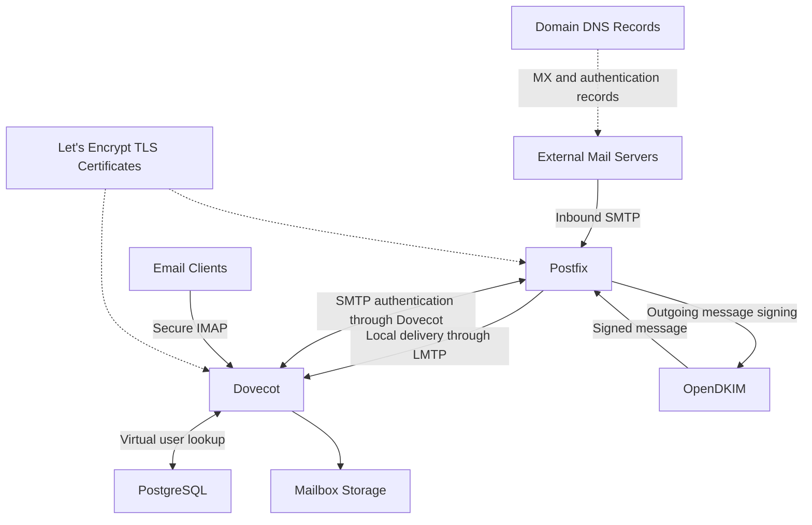
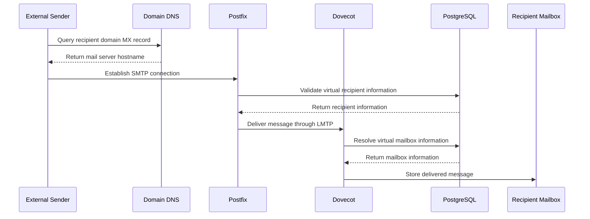
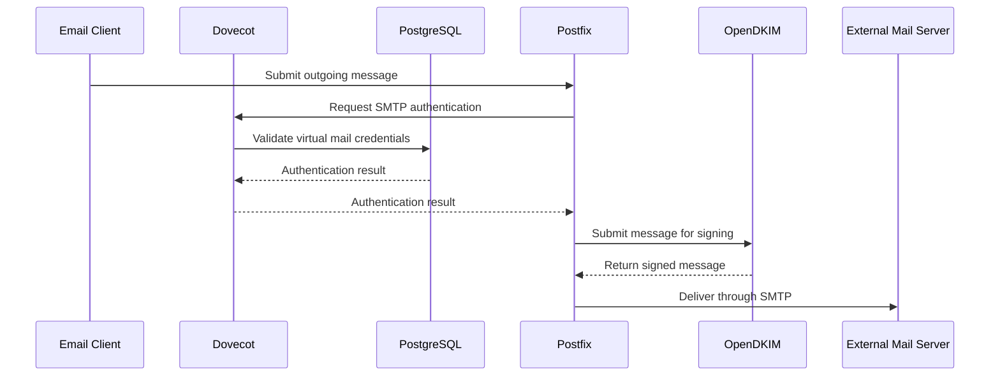

# Mail Server Infrastructure

## 1. Overview

The Area47 SDA Church infrastructure includes a self-hosted email server designed to support domain-based email communication. Instead of relying entirely on an external email hosting provider, the infrastructure uses independently configured Linux mail services to handle email transfer, authentication, mailbox delivery, and access. The mail server operates on the Ubuntu 24.04 VPS and uses the following technologies:

| Component | Technology | Responsibility |
|---|---|---|
| Mail Transfer Agent | Postfix | Handles incoming and outgoing email transfer |
| Mail Delivery and Access | Dovecot | Handles mailbox access, authentication, and local mail delivery |
| Database | PostgreSQL | Stores virtual mail account information |
| Email Signing | OpenDKIM | Provides DKIM email signing |
| Encryption | Let's Encrypt | Provides TLS certificates |
| DNS Management | Cloudflare | Manages domain DNS records |

The infrastructure supports virtual mail users, meaning email accounts are managed independently of the Linux system accounts and Django application authentication users.

This document describes the architecture and configuration responsibilities of the self-hosted mail infrastructure.

## 2. Mail Server Architecture

The mail infrastructure is built around the integration of Postfix, Dovecot, and PostgreSQL. Each component has a distinct responsibility, while together they provide a complete email service.

### High-level architecture

The architecture separates the responsibilities of mail transfer, authentication, mailbox delivery, and storage. Postfix handles mail transport, while Dovecot provides mailbox access and authentication services. PostgreSQL maintains virtual mail account information, and OpenDKIM supports outgoing email authentication.

## 3. Postfix - Mail Transfer Agent

Postfix is the primary Mail Transfer Agent (MTA) in the infrastructure. It is responsible for receiving and sending email messages using SMTP.

### Responsibilities

Postfix handles:

- Receiving incoming email from external mail servers.
- Processing outgoing email.
- Managing SMTP connections.
- Authenticating users for authorised mail submission through Dovecot.
- Delivering locally hosted messages to Dovecot through LMTP.
- Integrating with OpenDKIM for outgoing email signing.

### Incoming email

When another mail server sends a message to an Area47 email address, it identifies the destination mail server through the domain's MX record. The sending server establishes an SMTP connection with Postfix. Postfix processes the incoming message and, when the recipient is hosted locally, passes it to Dovecot using LMTP for mailbox delivery.

### Outgoing email

When an authorised user submits an email, Postfix handles the outgoing message. Dovecot provides the authentication service used by Postfix to verify the submitting user. OpenDKIM is integrated into the outgoing mail flow to provide DKIM signing before the message is delivered to its external destination.

## 4. Dovecot - Mail Access and Delivery

Dovecot provides mailbox access, authentication, and local mail delivery services. It works alongside Postfix to support the complete email lifecycle.

### Responsibilities

Dovecot provides:

- IMAP mailbox access.
- Secure IMAP connections.
- SMTP authentication support for Postfix.
- Local message delivery through LMTP.
- Virtual mail user authentication and lookup integration.

### IMAP access

Email clients connect to Dovecot to access their mailboxes. The infrastructure provides secure IMAP access over IMAPS on port 993. IMAP allows users to access and synchronise mailbox contents across supported email clients.

### SMTP authentication

Postfix uses Dovecot for SMTP authentication. This integration allows Dovecot to validate user credentials when authenticated clients submit outgoing messages. This separates mail transport from the authentication mechanism used to authorise users.

### LMTP delivery

Postfix uses the Local Mail Transfer Protocol (LMTP) to deliver locally hosted messages to Dovecot. LMTP provides the delivery interface between the mail transfer service and the mailbox service. This allows Postfix to handle message transport while Dovecot manages the local mailbox delivery process.

## 5. PostgreSQL - Virtual Mail User Database

PostgreSQL is used to store virtual mail account information. The mail server maintains its own virtual mail user records rather than directly using Linux system accounts or Django's application authentication users.

This provides separation between:

- Linux server administration accounts.
- Django website user accounts.
- Email mailbox accounts.

### Virtual mail accounts

Postfix and Dovecot integrate with PostgreSQL to obtain the information required for virtual mail domain and user handling. The database includes the `website_mailuser` table used by the mail infrastructure. The virtual mail account arrangement allows mailbox management to operate independently of the website's custom user model.

### Benefits of virtual mail users

- Mailbox accounts do not require individual Linux system users.
- Email authentication is separated from website authentication.
- Mail account management can be handled independently of Django application accounts.
- Multiple domain-based email accounts can be managed through the mail infrastructure.

## 6. Email Authentication and Message Flow

The mail server supports both inbound and outbound email processing. Understanding these flows is important because sending and receiving email involve different SMTP operations.

### 6.1 Incoming email flow

The external sender identifies the destination mail server through DNS and sends the message to Postfix. Postfix processes the message and uses the configured virtual mail information to handle the recipient. For locally hosted recipients, the message is delivered to Dovecot through LMTP. Dovecot manages the final mailbox delivery.

### 6.2 Outgoing email flow

An authenticated email client submits an outgoing message through Postfix. Dovecot validates the user's credentials using the configured virtual mail account information. After authentication, Postfix processes the message and integrates with OpenDKIM for signing before attempting external delivery.

## 7. OpenDKIM - Email Signing

OpenDKIM is used to provide DomainKeys Identified Mail (DKIM) signing. DKIM helps receiving mail servers verify that a message was signed by an authorised domain and that the signed portions of the message have not been modified in transit.

### Signing process

The outgoing mail flow integrates Postfix with OpenDKIM. OpenDKIM uses the configured signing identity and private key to generate a DKIM signature. The corresponding public key is published through the domain's DNS records. Receiving mail servers can use this public key to verify the signature.

### Benefits

- Provides a method for verifying outgoing email signatures.
- Helps establish domain email authenticity.
- Supports DMARC authentication and alignment.
- Reduces the likelihood of legitimate domain email being treated as unauthenticated or suspicious.

Private DKIM signing keys are maintained securely on the server and must never be committed to the public documentation repository.

## 8. DNS Configuration and Email Authentication

Correct DNS configuration is essential for reliable email delivery. The mail infrastructure uses Cloudflare for DNS management. The domain's DNS configuration includes the records required for mail routing and email authentication.

### 8.1 MX Records

Mail Exchange (MX) records identify the mail server responsible for receiving messages addressed to the domain. External mail servers query the recipient domain's MX records to determine where to deliver incoming email.

### 8.2 SPF Records

Sender Policy Framework (SPF) specifies which mail servers are authorised to send messages on behalf of a domain. Receiving mail servers can evaluate SPF to determine whether a message originated from an authorised sending server.

### 8.3 DKIM Records

DKIM records publish the public key required by receiving mail servers to verify messages signed by OpenDKIM. This works together with the private signing key maintained on the mail server.

### 8.4 DMARC Records

Domain-based Message Authentication, Reporting and Conformance (DMARC) defines how receiving mail servers should handle messages that fail the applicable SPF and DKIM alignment checks. The domain uses a quarantine policy for messages that fail the configured DMARC checks. DMARC also provides a framework for receiving authentication reports, depending on the configured reporting addresses and DNS policy.

### DNS record responsibilities

| Record | Purpose |
|---|---|
| MX | Directs incoming email to the mail server |
| SPF (TXT) | Identifies authorised sending infrastructure |
| DKIM (TXT) | Publishes the public key for signature verification |
| DMARC (TXT) | Defines the domain's email authentication policy |
| A/AAAA | Resolves service hostnames to their network addresses |

The DNS records must remain consistent with the actual mail server configuration.

## 9. TLS and Encrypted Mail Connections

TLS encryption is used to protect communication with the mail infrastructure. Let's Encrypt provides SSL/TLS certificates for the relevant service hostnames. Separate certificates are maintained for the different services rather than using a single shared certificate for every hostname.

### Secure mail access

Dovecot provides secure IMAP access over port 993. TLS certificates allow supported email clients to establish encrypted connections to the mail server.

### SMTP encryption

Postfix supports encrypted SMTP communication according to its configured TLS settings. TLS helps protect mail transport connections between participating servers and authenticated mail clients. It is important to distinguish between encryption of the connection to a mail server and end-to-end email encryption. TLS does not guarantee that an email remains encrypted throughout every stage of its delivery.

## 10. Mail Domain and Service Organisation

The infrastructure uses a dedicated mail hostname: `mail.area47sda.com`

The primary website and mail infrastructure use their respective hostnames.

| Hostname | Purpose |
|---|---|
| `area47sda.com` | Main website |
| `staging.area47sda.com` | Staging website |
| `mail.area47sda.com` | Mail server |

The mail server operates independently of the Django website's authentication system. This separation allows website functionality and email services to be managed as distinct infrastructure components.

## 11. Security Considerations

A self-hosted mail server requires particular attention to security because it accepts external connections and handles sensitive communications. The infrastructure incorporates several security mechanisms.

### Authentication

Dovecot provides authentication for mail users, including the SMTP authentication integration with Postfix. Virtual mail accounts are maintained independently of Linux system accounts.

### Network access

UFW is used to control incoming network access to the VPS. Only the network services required by the website and mail infrastructure should be exposed. Internal database services should remain restricted to authorised connections.

### Intrusion prevention

Fail2ban is installed to help reduce repeated unauthorised authentication attempts against configured services.

### Email authentication

SPF, DKIM, and DMARC work together to improve domain email authentication and reduce spoofing.

### TLS encryption

Let's Encrypt certificates provide encrypted connections for the configured mail services.

### Sensitive configuration

The following information must remain private:

- Mailbox passwords.
- PostgreSQL credentials.
- DKIM private keys.
- TLS private keys.
- Postfix and Dovecot authentication secrets.
- Internal server configuration containing sensitive values.

These details should never be published in a public technical documentation repository.

## 12. Mail Server Administration and Maintenance

Operating a self-hosted mail server requires continuous maintenance. The administrator must monitor the mail services, investigate delivery failures, maintain authentication configuration, and ensure that certificates and DNS records remain valid.

Important maintenance activities include:

- Checking Postfix service status.
- Checking Dovecot service status.
- Reviewing mail delivery logs.
- Investigating failed SMTP authentication attempts.
- Monitoring mailbox and disk usage.
- Checking virtual mail user configuration.
- Monitoring TLS certificate validity.
- Reviewing SPF, DKIM, and DMARC configuration.
- Applying operating system and mail software updates.
- Investigating message delivery and rejection problems.

Logs are especially important when diagnosing problems because mail delivery involves multiple services and external mail servers.

## 13. Challenges and Operational Considerations

Running a self-hosted mail infrastructure introduces several responsibilities beyond installing Postfix and Dovecot.

### Email deliverability

Successful outgoing delivery depends on correct DNS configuration, authentication, server reputation, and receiving mail server policies. A message can be accepted by the local mail server but still be rejected or classified as spam by a remote provider.

### DNS consistency

MX, SPF, DKIM, and DMARC records must reflect the actual mail server configuration. Incorrect or outdated records can affect incoming delivery, outgoing authentication, and domain reputation.

### Service integration

Postfix, Dovecot, PostgreSQL, and OpenDKIM must be configured to work together. Problems in one component can affect the complete mail delivery process.

### Certificate management

TLS certificates must remain valid for the hostnames used by the relevant services. Certificate renewal and service configuration must be monitored to avoid encrypted connection failures.

### Storage and availability

Mailbox data requires ongoing storage management and an appropriate backup and recovery strategy. The mail infrastructure also depends on the availability of the underlying VPS, network connectivity, DNS, and its supporting services.

## 14. Future Improvements

Potential improvements to the mail infrastructure include:

- Implementing automated mailbox and mail database backups.
- Establishing tested mailbox restoration procedures.
- Introducing centralised mail log monitoring.
- Monitoring mail queue size and delivery failures.
- Improving automated service health checks.
- Monitoring email authentication reports.
- Reviewing mail server security configuration periodically.
- Establishing documented mail server disaster recovery procedures.
- Improving mail service alerting and operational reporting.

These improvements would strengthen the reliability and maintainability of the self-hosted email infrastructure.

## 15. Summary

The Area47 SDA Church mail infrastructure is a self-hosted email system built around Postfix, Dovecot, PostgreSQL, and OpenDKIM.

Postfix handles incoming and outgoing SMTP traffic, while Dovecot provides mailbox access, SMTP authentication, and local delivery through LMTP.

PostgreSQL stores virtual mail account information independently of the Django application's user accounts.

OpenDKIM provides outgoing message signing, while SPF and DMARC DNS records support domain-level email authentication.

Let's Encrypt certificates provide TLS encryption for the configured services.

The project demonstrates practical experience in Linux mail server administration, SMTP and IMAP services, virtual mail users, database integration, DNS-based email authentication, and the operation of self-hosted infrastructure.
